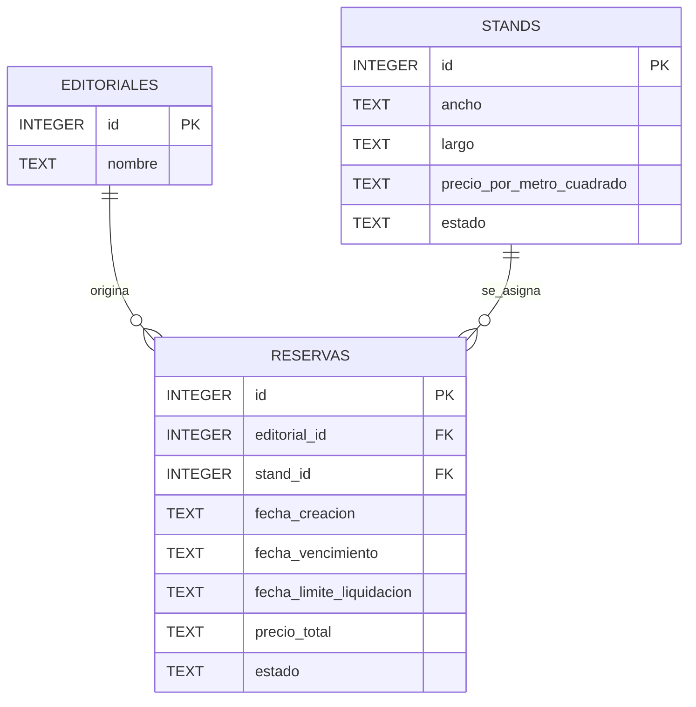

# PD4 — Sistema de stands con JDBC y SQLite

## Descripción

El programa administra stands de la FILEY y demuestra lecturas JDBC desde una base SQLite local. Al iniciar, `Main`:

1. Abre la conexión JDBC y muestra su URL.
2. Lee e imprime las tablas `stands`, `editoriales` y `reservas`.
3. Ejecuta la demostración existente de reservas, pagos, estados y avisos en memoria.

La conexión, el esquema y los datos de demostración se preparan automáticamente. No se requiere instalar ni iniciar un servidor de base de datos.

## Requerimientos del software

### Funcionales

- **RF-01 — Conexión:** al iniciar, el sistema debe abrir una conexión JDBC con SQLite e indicar en consola que se conectó.
- **RF-02 — Esquema:** debe crear, si no existen, las tablas `stands`, `editoriales` y `reservas`, con claves foráneas de reservas hacia las otras dos tablas.
- **RF-03 — Datos de demostración:** debe insertar registros de ejemplo si sus identificadores aún no existen, evitando duplicarlos al volver a ejecutar el programa.
- **RF-04 — Consultas:** debe leer todos los registros de stands, editoriales y reservas mediante sus respectivos DAO.
- **RF-05 — Presentación:** debe mostrar en consola los resultados de las tres consultas, incluyendo los datos relacionados de editorial y stand en cada reserva.
- **RF-06 — Listas vacías:** debe indicar cuando una tabla consultada no contiene registros.
- **RF-07 — Demostración del dominio:** debe conservar la simulación en memoria de reservas, pagos, estados de stands y avisos.

### No funcionales

- **RNF-01 — Arquitectura:** separar presentación, controlador, acceso a datos y lógica del dominio.
- **RNF-02 — Persistencia local:** guardar la base en `PD4/filey.db`; los datos almacenados permanecen entre ejecuciones.
- **RNF-03 — Independencia de servidor:** usar SQLite embebido, sin requerir un servidor de base de datos.
- **RNF-04 — Integridad:** aplicar claves foráneas y consultas JDBC con parámetros.
- **RNF-05 — Recursos y errores:** cerrar conexiones y recursos JDBC correctamente y no ocultar errores de conexión o consulta.
- **RNF-06 — Importes:** conservar el total acordado en cada reserva, aunque después cambie el precio del stand.

La lectura y los datos de demostración sí usan la base de datos. Las acciones posteriores de la simulación de negocio de `Main` (pagos y cambios de estado) se ejecutan en memoria y no se guardan en SQLite.

## Requisitos para ejecutar

- **JDK 17 o posterior**.
- **Apache Maven 3.6.3 o posterior**.
- Acceso a Internet durante la primera compilación para que Maven descargue el driver SQLite JDBC y los complementos declarados en `pom.xml`. Después se pueden usar desde el repositorio local de Maven.

El driver `org.xerial:sqlite-jdbc` se descarga como dependencia de Maven; no es necesario instalar SQLite por separado.

## Organización

El código fuente se encuentra en `main/java` (la ruta está configurada en `pom.xml`) y se divide en estas responsabilidades:

- **Modelo** (`filey.modelo`): `StandDAO`, `EditorialDAO` y `ReservaDAO` consultan la base con JDBC y devuelven registros tipados (`StandRegistro`, `EditorialRegistro` y `ReservaRegistro`).
- **Controlador** (`filey.controlador`): `ControladorFiley` solicita las listas a los DAO.
- **Vista** (`filey.vista`): `VistaConsola` muestra la conexión y las filas en consola.
- **Persistencia** (`filey.persistencia`): `ConexionSQLite` abre la conexión, crea el esquema e inserta datos de ejemplo cuando corresponde.
- **Dominio y lógica** (`filey.datos`, `filey.negocio`): entidades y reglas de stands, editoriales, reservas y pagos.

## Diagrama de clases

El diagrama muestra las relaciones principales del dominio, la capa MVC y el acceso JDBC. `SQLiteFiley` representa la base de datos, no una clase Java.

```mermaid
classDiagram
    direction TB

    class Main {
        +main(argumentos) void
        -mostrarLecturasBaseDatos() void
        -imprimirResumenReserva(reservaConsultada) void
    }

    class Configuracion {
        -fechaLimiteDescuento LocalDate
        -fechaLimiteLiquidacion LocalDate
        -fechaLimiteReserva LocalDate
        -plazoPagoReservaEnDias int
        -diasAnticipacionNotificacion int
    }

    class Editorial {
        -identificadorEditorial int
        -nombreEditorial String
        +recibirNotificacion(mensajeNotificacion) void
    }

    class EstadoStand {
        <<enumeration>>
        DISPONIBLE
        RESERVADO
        OCUPADO
        BLOQUEADO
    }

    class Pago {
        -importePago BigDecimal
        -fechaPago LocalDate
    }

    class Reserva {
        -identificadorReserva int
        -fechaCreacionReserva LocalDate
        -fechaVencimiento LocalDate
        -fechaLimiteLiquidacion LocalDate
        -importeTotal BigDecimal
        -reservaVencida boolean
        +agregarPago(importePago, fechaPago) void
        +calcularSaldoPendiente() BigDecimal
        +cumplePagoMinimo() boolean
        +marcarVencidaSiCorresponde(fechaConsulta) boolean
    }

    class Stand {
        -identificadorStand int
        -anchoEnMetros BigDecimal
        -largoEnMetros BigDecimal
        -precioPorMetroCuadrado BigDecimal
        -estadoActual EstadoStand
        +crearReserva(...) Reserva
        +marcarComoBloqueado() void
        +quitarBloqueo() void
        +calcularPrecioTotal() BigDecimal
    }

    class SistemaFiley {
        -parametrosSistema Configuracion
        -standsRegistrados Map
        -editorialesRegistradas Map
        -reservasRegistradas Map
        +agregarStand(standNuevo) void
        +agregarEditorial(editorialNueva) void
        +reservarStand(identificadorEditorial, identificadorStand, fechaReserva) Reserva
        +agregarPagoReserva(identificadorReserva, importePago, fechaPago) void
        +revisarFechasLimite(fechaConsulta) void
    }

    class Observador {
        <<interface>>
        +recibirNotificacion(mensajeNotificacion) void
    }

    class Sujeto {
        <<interface>>
        +registrarObservador(identificadorEditorial, observador) void
        +eliminarObservador(identificadorEditorial, observador) void
        +enviarNotificacion(identificadorEditorial, mensajeNotificacion) void
    }

    class Notificador {
        -observadoresPorEditorial Map
    }

    class ControladorFiley {
        -standDAO StandDAO
        -editorialDAO EditorialDAO
        -reservaDAO ReservaDAO
        +listarStands() List
        +listarEditoriales() List
        +listarReservas() List
    }

    class VistaConsola {
        +mostrarConexion(urlConexion) void
        +mostrarStands(stands) void
        +mostrarEditoriales(editoriales) void
        +mostrarReservas(reservas) void
    }

    class ConexionSQLite {
        +abrirConexion() Connection
        -inicializarEsquema(conexion) void
        -insertarDatosDemostracion(conexion) void
    }

    class StandDAO {
        +listarTodos() List
    }

    class EditorialDAO {
        +listarTodas() List
    }

    class ReservaDAO {
        +listarTodas() List
    }

    class StandRegistro {
        <<record>>
        +identificadorStand int
        +anchoEnMetros BigDecimal
        +largoEnMetros BigDecimal
        +precioPorMetroCuadrado BigDecimal
        +estado String
    }

    class EditorialRegistro {
        <<record>>
        +identificadorEditorial int
        +nombreEditorial String
    }

    class ReservaRegistro {
        <<record>>
        +identificadorReserva int
        +identificadorEditorial int
        +identificadorStand int
        +fechaCreacion LocalDate
        +fechaVencimiento LocalDate
        +precioTotal BigDecimal
        +estado String
    }

    class Connection {
        <<JDBC>>
    }

    class SQLiteFiley {
        <<database>>
        stands
        editoriales
        reservas
    }

    Editorial ..|> Observador
    Notificador ..|> Sujeto
    SistemaFiley --> Configuracion
    SistemaFiley --> Sujeto : notificaciones
    SistemaFiley "1" o-- "0..*" Stand : standsRegistrados
    SistemaFiley "1" o-- "0..*" Editorial : editorialesRegistradas
    SistemaFiley "1" o-- "0..*" Reserva : reservasRegistradas
    Reserva "0..*" --> "1" Editorial : editorialResponsable
    Reserva "0..*" --> "1" Stand : standReservado
    Reserva "1" *-- "0..*" Pago : pagosRegistrados
    Stand --> EstadoStand

    ControladorFiley *-- StandDAO
    ControladorFiley *-- EditorialDAO
    ControladorFiley *-- ReservaDAO
    StandDAO --> StandRegistro : devuelve
    EditorialDAO --> EditorialRegistro : devuelve
    ReservaDAO --> ReservaRegistro : devuelve
    VistaConsola ..> StandRegistro : presenta
    VistaConsola ..> EditorialRegistro : presenta
    VistaConsola ..> ReservaRegistro : presenta

    ConexionSQLite --> Connection : abre
    StandDAO --> Connection : consulta
    EditorialDAO --> Connection : consulta
    ReservaDAO --> Connection : consulta
    ConexionSQLite ..> SQLiteFiley : crea y prepara
    StandDAO ..> SQLiteFiley : SELECT stands
    EditorialDAO ..> SQLiteFiley : SELECT editoriales
    ReservaDAO ..> SQLiteFiley : SELECT reservas

    Main ..> ConexionSQLite
    Main ..> ControladorFiley
    Main ..> VistaConsola
    Main ..> SistemaFiley : demostración de dominio
```



## Diagrama entidad-relación

El diagrama corresponde al esquema creado por `ConexionSQLite`. Cada reserva referencia exactamente una editorial y un stand; cada editorial o stand puede aparecer en cero o muchas reservas.



`RESERVAS.precio_total` conserva el importe acordado al crear la reserva, aunque después cambie el precio del stand.

## Base de datos

En el primer inicio se crea `filey.db` dentro de `PD4` al ejecutar desde la raíz del repositorio o desde el directorio `PD4`.

El esquema contiene:

| Tabla | Columnas principales |
|---|---|
| `stands` | `id`, `ancho`, `largo`, `precio_por_metro_cuadrado`, `estado` |
| `editoriales` | `id`, `nombre` |
| `reservas` | `id`, `editorial_id`, `stand_id`, `fecha_creacion`, `fecha_vencimiento`, `fecha_limite_liquidacion`, `precio_total`, `estado` |

`reservas.editorial_id` y `reservas.stand_id` son claves foráneas. Los datos de demostración se insertan con `INSERT OR IGNORE`, por lo que ejecutar el programa de nuevo no duplica esos registros. La base conserva los datos entre ejecuciones.

## Compilar y ejecutar

Desde la raíz del repositorio:

```powershell
mvn -f PD4\pom.xml clean compile exec:java
```

O desde el directorio `PD4`:

```powershell
mvn clean compile exec:java
```

El objetivo de Maven usa `filey.Main`. Al ejecutar desde VS Code, abre/importa el proyecto Maven de `PD4` y ejecuta esa clase.

## Reiniciar los datos de demostración

Para volver a crear la base desde cero, cierra el programa y elimina `PD4\filey.db`. La próxima ejecución recreará las tablas y los registros de demostración. **Esto elimina todos los datos almacenados en ese archivo.**
