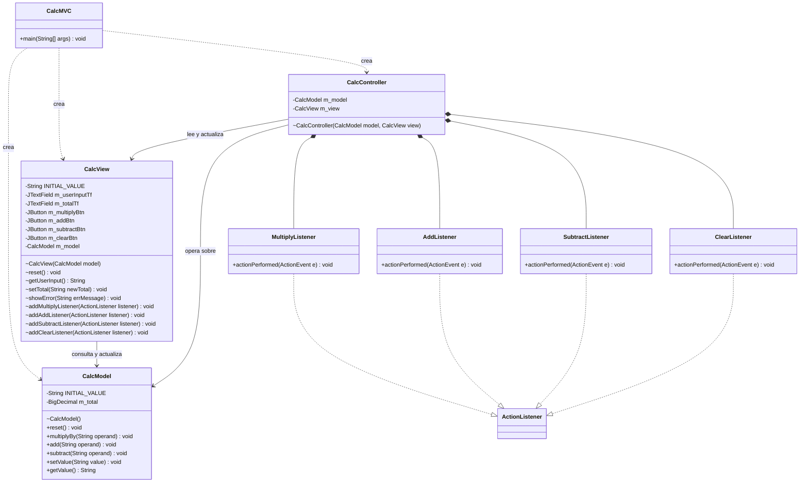

# PD3

Calculadora MVC que realiza la suma, resta y multiplicación de números sucesivos.

## Implementación de la suma y la resta

La multiplicación fue la operación inicial de la calculadora. Por eso, el acumulador comienza en `1`, su elemento neutro. La suma y la resta se añadieron siguiendo el mismo flujo de la multiplicación: cada operación toma el total actual y lo combina con el nuevo número ingresado.

### Suma

Al presionar **Add**, el `AddListener` del controlador:

1. Lee el texto ingresado en la vista mediante `getUserInput()`.
2. Llama a `CalcModel.add(operand)`.
3. El modelo convierte el texto a `BigDecimal` y actualiza el acumulador sumándole el operando: `m_total = m_total.add(new BigDecimal(operand))`.
4. El controlador obtiene el nuevo total con `getValue()` y lo muestra en la vista con `setTotal(...)`.

Por ejemplo, partiendo del valor inicial `1`, al sumar `5` y luego `3`, el acumulador queda en `9`.

### Resta

Al presionar **Subtract**, el `SubtractListener` ejecuta el mismo flujo, pero llama a `CalcModel.subtract(operand)`. El modelo convierte el texto a `BigDecimal` y resta el operando del acumulador: `m_total = m_total.subtract(new BigDecimal(operand))`.

Por ejemplo, partiendo de `1`, al restar `5` y luego `3`, el acumulador queda en `-7`. El orden importa: cada nuevo operando se aplica al total acumulado, no a una expresión completa.

### Validación y representación numérica

Ambas operaciones utilizan `BigDecimal`, que permite trabajar con enteros grandes y decimales. Si el texto ingresado no representa un número válido, la conversión genera `NumberFormatException`; el controlador captura la excepción y la vista muestra un mensaje de error. El resultado se presenta como texto sin notación científica mediante `getValue()`.

## Diagrama de clases

